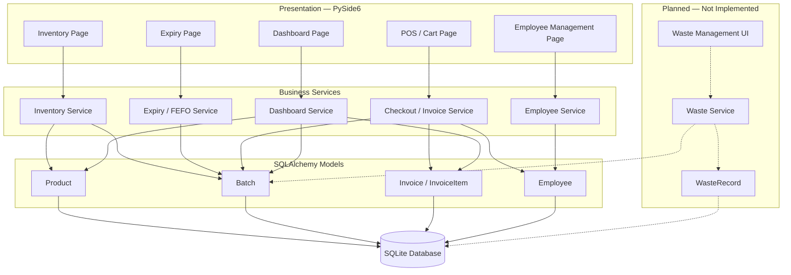
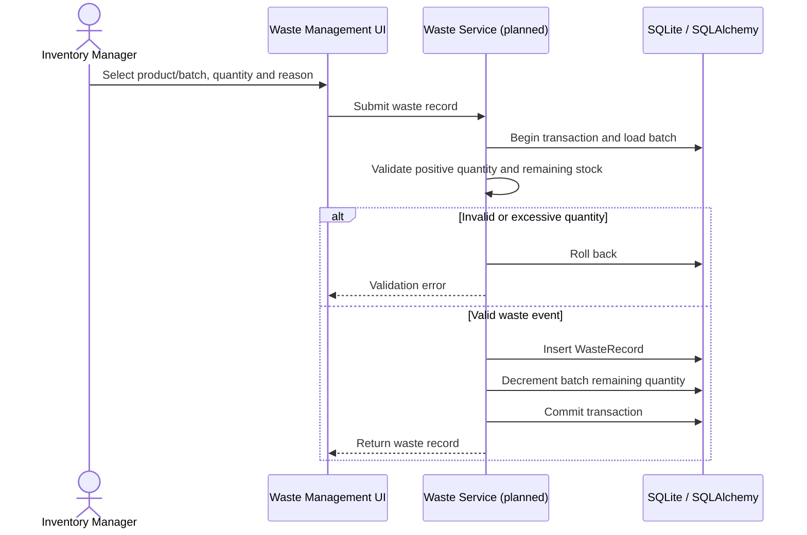

# Software Architecture and Design (SAD) Specification

## Perishables Management System — Expanded Retail Operations Scope

| Field | Value |
|---|---|
| Version | 1.1 |
| Date | 6 November 2026 |
| Authors | PMS Team — Deeksha, Chris, Janhavi, Chiranth |
| Primary owner | Member 4 — Chiranth |
| Status | Draft for peer review |
| Stack | Python 3, PySide6, SQLAlchemy, SQLite, pytest |

## Revision history

| Version | Date | Author | Summary |
|---|---|---|---|
| 0.1 | 28 Oct 2026 | Team | Initial design baseline |
| 1.0 | 5 Nov 2026 | Chiranth | Expanded inventory, POS, employees, waste, security and traceability |
| 1.1 | 6 Nov 2026 | Chiranth | Aligned architecture and implementation status with merged release evidence |

## 1. Introduction

### 1.1 Purpose

Describe the PMS architecture, major components, data responsibilities, interactions, security approach and design decisions. This document distinguishes implemented release functionality from planned waste-management and unverified access-control capabilities.

### 1.2 Scope

PMS is a local desktop retail application for perishable product inventory, batch management, expiry tracking, FEFO stock allocation, billing/invoices, employee management and dashboard summaries.

Waste management remains part of the expanded requirements but is not implemented in the current release.

### 1.3 Audience

Developers, testers, reviewers, evaluators and maintainers.

### 1.4 Definitions

- FEFO: First Expired, First Out.
- ORM: Object Relational Mapper.
- UI: User Interface.
- RBAC: Role-Based Access Control.
- RTM: Requirements Traceability Matrix.
- POS: Point of Sale.

## 2. Document overview

### 2.1 How to use this document

Use the component and sequence views to understand module boundaries and interactions. Use the design decisions and traceability sections to evaluate changes. Update this document when implementation materially changes.

### 2.2 Related documents

- `SRS.md`
- `TEST_PLAN.md`
- `RTM.md`
- `PROJECT_SCOPE_AND_TEAM_PLAN.md`

## 3. Architecture

### 3.1 Architecture goals and constraints

Goals:

- Keep UI, business rules and persistence concerns separate.
- Maintain stock/invoice consistency during checkout.
- Make business logic testable without launching the GUI.
- Support local inventory and billing operations.
- Preserve historical invoice and inventory records.
- Provide a structure that can support future waste traceability.

Constraints:

- Python/PySide6 desktop application.
- SQLite local relational database via SQLAlchemy.
- Existing team codebase and test workflow.
- No confirmed cloud or multi-store service.

### 3.2 Stakeholders and concerns

| Stakeholder | Primary concern |
|---|---|
| Cashier | Fast checkout, correct totals and cashier attribution |
| Inventory manager | Accurate batches, expiry and FEFO |
| Administrator | Employee lifecycle and administration |
| Developer | Modular code, clear service contracts and maintainability |
| Evaluator | Requirements alignment, test evidence and documented deviations |

Waste recording and waste reporting are expanded-scope requirements, not currently operational capabilities.

### 3.3 Chosen architectural pattern

**Layered modular monolith.**

The application is organised into:

1. Presentation layer (`src/ui/`) — PySide6 pages and dialogs.
2. Service/business layer (`src/services/`) — validation, stock allocation, checkout, employee operations and summaries.
3. Domain/data layer (`src/models/`) — SQLAlchemy entities and relationships.
4. Persistence/infrastructure (`src/database/`) — engine, session and schema initialisation.
5. Quality layer (`tests/`, `.github/workflows/`) — pytest and CI.

A microservices architecture is not selected. The current system is a single-workstation desktop application with no demonstrated need for independently deployed services or distributed transactions.

### 3.4 Component diagram



The planned components are shown separately and are not part of the current operational application workflow.

### 3.5 Component descriptions

| Component | Responsibility | Key behaviour / state |
|---|---|---|
| Dashboard UI/service | Display operational summaries | Displays product, low-stock, expiry, daily sales and invoice information. Waste metric is not implemented. |
| Inventory UI/service | Product and batch CRUD/receiving | Validates SKU, names, prices, thresholds, received quantity and expiry date. |
| Expiry service | Identify expired and near-expiry batches | Filters positive remaining stock, applies a configurable day horizon and sorts by expiry. |
| Checkout service | Validate cart, allocate stock and create invoice | FEFO allocation; rejects insufficient valid stock; invoice and batch updates occur in one transaction with rollback on failure. |
| Invoice service/models | Store invoice header and item snapshots | Unique invoice number, cashier snapshot, item quantities and monetary totals. |
| Employee UI/service | Employee profile lifecycle and cashier selection | Employee management functionality is included in the merged release. Create, edit, activate/deactivate and cashier-related workflows are included. |
| Waste service/UI | Record waste and update affected batch | Not implemented in the current release. No verified working waste model/service/UI. |
| Database layer | SQLAlchemy engine/session and SQLite persistence | Schema creation and transaction boundaries. |
| CI/test layer | Automated validation | pytest suite and GitHub Actions. |

### 3.6 Technology stack and data stores

| Layer | Technology |
|---|---|
| Language | Python 3 |
| Desktop UI | PySide6 |
| ORM | SQLAlchemy |
| Database | SQLite |
| Automated tests | pytest / pytest-qt where applicable |
| CI | GitHub Actions |
| Version control | Git / GitHub |

SQLite is appropriate for the current single-user/local academic scope. A future multi-user deployment may require a client-server database and concurrency review.

### 3.7 Data model overview

- **Product:** SKU, name, category, supplier, cost price, selling price, low-stock threshold and active flag.
- **Batch:** product reference, batch code, received quantity, remaining quantity, expiry date and received timestamp.
- **Invoice:** unique invoice number, timestamp, cashier snapshot, optional customer mobile/email, subtotal and total.
- **InvoiceItem:** invoice reference, optional product reference, product name/SKU snapshot, quantity, unit price and line total.
- **Employee:** employee code, full name, optional email/phone, role and active status. Employee management is included in the merged release.
- **WasteRecord (proposed):** batch reference, product reference, quantity, reason, event timestamp, recorded-by employee reference, cost snapshot and notes. This is a proposed design, not an existing model.

### 3.8 Key design decisions (ADRs)

**ADR-001 — Layered modular monolith**

- Decision: retain a single desktop application with UI, service, model and database layers.
- Rationale: fits team size and local deployment; simple to test and demonstrate.
- Consequence: no independent service deployment; shared database transaction management remains central.

**ADR-002 — SQLite + SQLAlchemy**

- Decision: use SQLite through SQLAlchemy.
- Rationale: local setup, relational integrity and ORM-based tests.
- Consequence: concurrent multi-workstation use is not a target capability.

**ADR-003 — FEFO stock allocation**

- Decision: allocate eligible batches by ascending expiry date, then batch ID.
- Rationale: reduce expiry-related wastage and avoid selling expired stock.
- Consequence: tests must cover ties, expired stock, depleted stock and insufficient quantity.

**ADR-004 — Atomic checkout**

- Decision: invoice creation and batch deductions occur in one database transaction.
- Rationale: avoid invoices without stock deduction or stock deduction without invoice.
- Consequence: all failure paths must roll back.

**ADR-005 — Waste recording as a separate auditable transaction**

- Decision: proposed WasteRecord entity references product/batch and records quantity, reason, actor and time; decrement batch remaining quantity in the same transaction.
- Rationale: distinguish waste from sales while retaining stock accountability.
- Status: not implemented; requires model, service, UI, tests and dashboard integration.

**ADR-006 — Employee identity and invoice attribution**

- Decision: employee management and cashier attribution are included in the merged release. Historical invoice information retains cashier display information.
- Rationale: employee identity supports cashier accountability while historical invoices remain understandable.
- Status: employee management changes have been merged. The release has passed the reported regression and manual workflow checks.

### 3.9 Risks and mitigations

| Risk | Mitigation |
|---|---|
| SQLite database corruption or accidental deletion | Back up database before release; document restore procedure; avoid editing DB manually. |
| Race condition / concurrent stock update | Transactional checkout and conditional batch updates; test failure/rollback. |
| Incorrect expiry date entry | Input validation, clear date format and review receiving workflow. |
| Waste feature absent while scope promises it | Record as a scope deviation; implement before claiming full acceptance or explicitly defer with evaluator/team approval. |
| Unauthorised employee/customer data access | Confirm authentication/RBAC requirements; minimise displayed contact data; keep secrets out of logs. |
| Email provider unavailable | Keep invoice commit independent of email result; report email failure clearly. |

### 3.10 Traceability to requirements

- Inventory service and Product/Batch models: PMS-FR-001 through PMS-FR-006.
- Expiry service and checkout FEFO: PMS-FR-007 through PMS-FR-010.
- Checkout and Invoice services/models: PMS-FR-012 through PMS-FR-019.
- Employee service/model and checkout attribution: PMS-FR-020 through PMS-FR-024.
- Proposed WasteRecord and Waste service/UI: PMS-FR-025 through PMS-FR-030.
- Dashboard service: PMS-FR-031 through PMS-FR-033.
- Security controls: PMS-SEC-001 through PMS-SEC-006.

Waste requirements remain unimplemented. Authentication, role-based permissions and complete audit coverage have not been confirmed as implemented.

### 3.11 Security architecture and threat model

Apply least privilege, service-layer validation, safe error handling and data minimisation. Authentication and RBAC are not confirmed as implemented in the current release.

The following STRIDE-style risks require validation:

| Threat | Example | Mitigation / evidence |
|---|---|---|
| Spoofing | User claims to be a manager/cashier | Authenticated identity and role checks; implementation not confirmed. |
| Tampering | User changes batch quantity or invoice total | Service validation, DB constraints and transactions. |
| Repudiation | Employee denies completing a sale | Cashier attribution on invoices; full audit trail not confirmed. |
| Information disclosure | Customer email/mobile appears in logs/screenshots | Redaction, limited display and synthetic test data. |
| Denial of service | Malformed input or repeated failed operation | Input validation and safe error handling. |
| Elevation of privilege | Cashier accesses employee administration | RBAC enforcement and negative permission tests; implementation not confirmed. |

## 4. Design

### 4.1 Design overview

UI components call service functions; services validate inputs and manage SQLAlchemy sessions/transactions; models define persisted entities. UI code should not independently implement stock allocation or duplicate business rules.

### 4.2 Sequence diagram — checkout and FEFO

```mermaid
sequenceDiagram
    actor Cashier
    participant UI as POS / Cart UI
    participant CS as Checkout Service
    participant DB as SQLite / SQLAlchemy
    participant IS as Invoice Service

    Cashier->>UI: Select products and quantities
    UI->>CS: Submit checkout
    CS->>DB: Begin transaction / load active products
    CS->>DB: Load valid batches ordered by expiry
    CS->>CS: Validate stock and allocate FEFO quantities

    alt Invalid cart or insufficient stock
        CS->>DB: Roll back
        CS-->>UI: Validation error
        UI-->>Cashier: Show error; retain cart
    else Valid checkout
        CS->>IS: Create invoice and item snapshots
        IS->>DB: Insert invoice and invoice items
        CS->>DB: Conditionally decrement allocated batches
        CS->>DB: Commit transaction
        CS-->>UI: Return persisted invoice
        UI-->>Cashier: Display/export invoice
    end
```

### 4.3 Sequence diagram — proposed waste recording

This diagram describes a future workflow only. It does not represent a currently implemented feature.



### 4.4 API / service interface design

The application is a desktop monolith; these are internal Python service contracts, not HTTP REST endpoints.

| Service operation | Inputs | Output | Errors / rules |
|---|---|---|---|
| `create_product(session, sku, name, category, ...)` | Product fields | Product | Reject blank required fields, negative prices/threshold and duplicate SKU. |
| `add_batch(session, product_id, batch_code, quantity_received, expiry_date)` | Batch receipt | Batch | Reject missing/inactive product, blank code, non-positive quantity and invalid date. |
| `get_expiring_batches(session, days=7, as_of=None)` | Horizon and reference date | Ordered Batch list | `days` must be a non-negative integer. |
| Checkout operation | Cashier, cart and optional contact/employee information | Invoice | Reject empty cart, invalid IDs/quantities, inactive product/employee and insufficient valid stock; rollback on error. |
| `record_waste(batch_id, quantity, reason, actor_id, notes=None)` | Proposed waste data | WasteRecord | Planned; validate quantity/reason/actor and atomic batch decrement. |

The checkout operation is described at the architectural level. Refer to the actual checkout service implementation for the exact function signature and arguments.

### 4.5 Error handling, logging and monitoring

- Service functions raise clear validation errors for invalid operations.
- Checkout catches failures, rolls back the transaction and re-raises the error for UI display.
- UI must not expose stack traces to normal users.
- Logs may contain operation type, timestamp and non-sensitive identifiers; never log passwords, secrets or full customer contact values.
- Dashboard summaries should query persisted records rather than rely only on UI state.
- Monitor test pass/fail, checkout failures, low-stock counts and expiry counts.
- Waste monitoring can be added after waste functionality is implemented.

### 4.6 UX design

Use consistent page titles, required-field indicators, clear date and currency formatting, confirmation before deactivation and actionable validation messages. Employee pages should clearly display active status and relevant employee information. Do not expose customer contact data to roles that do not need it.

Waste-related screens and workflows are planned and should not be presented as implemented functionality.

### 4.7 Open issues and next steps

1. Implement WasteRecord model, service, UI and tests if waste management remains in the accepted evaluation scope.
2. Confirm whether full login/RBAC is required in the current evaluation scope; if required, implement and test it.
3. Confirm tax/discount policy and customer contact requirements.
4. Verify the extent of persistent audit records for stock adjustments and employee changes.
5. Run additional performance, usability and portability measurements if required by the NFR acceptance criteria.
6. Complete final documentation and Jira acceptance-criteria review.

## 5. Appendices

### 5.1 Glossary

Batch, FEFO, POS, SKU, ORM, RBAC, PII, RTM, UAT.

### 5.2 References

Supplied PMS problem statement, repository scope and README, SRS/Test Plan templates, evaluation checklist and project source modules.

### 5.3 Tools

Mermaid-compatible diagrams, draw.io if a graphical export is required, pytest, GitHub Actions and GitHub pull requests.

### 5.4 Release verification evidence

The release verification reported on 6 November 2026 includes:

- Full automated test suite: 111 tests passed.
- Clean-checkout verification: fresh clone, dependency installation, tests and application launch succeeded.
- Manual smoke testing: all six listed smoke-test areas passed.
- Functional workflows: all six listed workflows passed.
- PR #21 merged into `main`, with all reported PR checks passing.
- Demo video saved under `docs/evidence/demo.mov` and verified to play correctly.

These results establish the reported release verification state; they do not imply that unimplemented waste-management or unverified security features have passed testing.