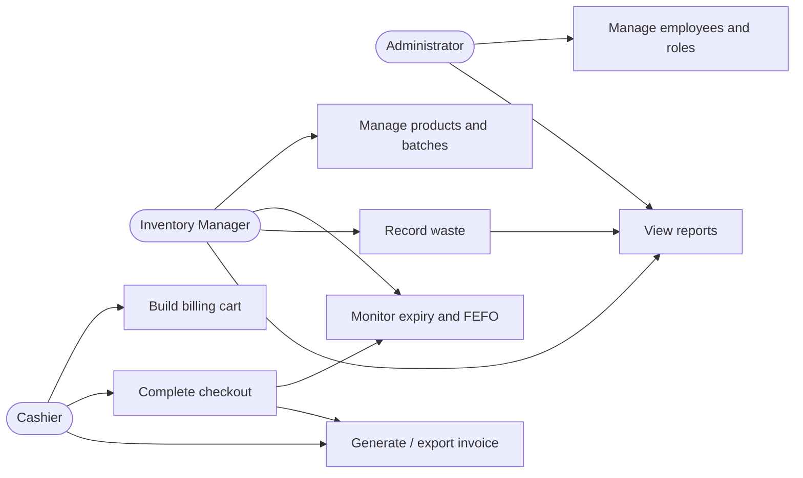

# Software Requirements Specification (SRS)
## Perishables Management System (PMS) — Expanded Retail Operations Scope

| Field | Value |
|---|---|
| Version | 1.0 — Expanded-scope draft |
| Date | 5 November 2026 |
| Status | Draft for team review |
| Project | Perishables Management System |
| Team | Deeksha, Chris, Janhavi, Chiranth |
| Primary documentation owner | Member 4 — Chiranth |
| Technology baseline | Python 3, PySide6, SQLite, SQLAlchemy, pytest, GitHub Actions |

> **Document status note:** This SRS is based on the supplied problem statement, project scope document, repository README and inspected implementation files. Requirements marked Planned or Not implemented are target requirements, not claims about existing functionality. Confirmed implementation status must be rechecked against the final merged release branch before approval.

## Revision history

| Version | Date | Author | Change |
|---|---|---|---|
| 0.1 | 28 Oct 2026 | Team | Initial PMS scope and baseline |
| 1.0 | 5 Nov 2026 | Chiranth / Member 4 | Expanded inventory, billing, employee, waste, security, NFR and traceability scope |

## Approval

| Role | Name | Approval |
|---|---|---|
| Team / Product representative | Team decision required | Pending |
| Developer representative | Team decision required | Pending |
| QA representative | Team decision required | Pending |

## 1. Introduction

### 1.1 Purpose
This SRS specifies the functional and non-functional requirements for PMS, a desktop application intended to help retail stores manage perishable products, stock batches, expiry, checkout, invoices, employees and wastage. It provides a common basis for implementation, testing, review and evaluation.

### 1.2 Scope
PMS is intended for a single retail-store deployment using a desktop interface and a local relational database. It manages products and batches, monitors expiry, prioritises stock using First Expired, First Out (FEFO), supports point-of-sale checkout and invoice records, attributes invoices to cashiers, and is intended to record and analyse waste.

The system includes:
- Product catalogue and batch-level inventory.
- Stock quantities, low-stock thresholds and stock validation.
- Expiry monitoring and FEFO allocation during checkout.
- Billing cart, checkout validation, invoice creation and invoice export.
- Optional customer mobile/email capture and invoice email delivery where configured.
- Employee profiles, active/inactive status and cashier attribution.
- Waste recording and reporting as an expanded requirement.
- Dashboard summaries and audit/security controls.

Out of scope for the current desktop release unless separately approved: multi-store cloud synchronisation, supplier payment/accounting, barcode hardware integration, automated demand forecasting, mobile applications, regulatory food-safety certification and integration with external ERP/POS platforms.

### 1.3 Intended audience
Project team members, instructors/evaluators, developers, testers and future maintainers.

### 1.4 Definitions and abbreviations
- **PMS:** Perishables Management System.
- **SKU:** Stock Keeping Unit; unique product identifier.
- **Batch:** A received quantity of a product sharing a batch code and expiry date.
- **FEFO:** First Expired, First Out; allocate the valid batch with the earliest expiry first.
- **POS:** Point of Sale.
- **FR/NFR:** Functional / Non-functional Requirement.
- **RTM:** Requirements Traceability Matrix.
- **RBAC:** Role-Based Access Control.
- **UAT:** User Acceptance Testing.
- **PII:** Personally Identifiable Information, such as customer contact details.

### 1.5 References
- Supplied PMS problem statement: “An app to manage optimally all perishables (like fresh fruits/vegetables) in retail stores.”
- `docs/PROJECT_SCOPE_AND_TEAM_PLAN.md`.
- Repository `README.md`.
- Supplied SRS, SAD and Test Plan templates.
- Supplied mini-project evaluation checklist and demo FAQs.
- IEEE-style SRS structure as represented by the supplied course template.

## 2. Overall description

### 2.1 Product perspective
PMS is a Python desktop application. The presentation layer is built with PySide6; service modules implement business rules; SQLAlchemy maps domain objects to a SQLite database. pytest is used for automated tests and GitHub Actions runs CI checks. The architecture is a layered modular monolith, not a distributed microservices system.

### 2.2 Product functions
1. Create, view, update and deactivate product records.
2. Receive stock into identifiable batches with quantities and expiry dates.
3. Calculate available stock from remaining batch quantities.
4. Display expired and soon-to-expire batches.
5. Allocate checkout quantities using FEFO and reject insufficient valid stock.
6. Maintain a billing cart and validate line quantities and prices.
7. Generate a unique invoice and preserve item/price snapshots.
8. Deduct stock only when checkout commits successfully.
9. Capture cashier identity and associate it with an invoice.
10. Maintain employee records and active/inactive status.
11. Record waste quantities, reasons, dates and affected batches (planned).
12. Summarise inventory, expiry, sales and waste data on the dashboard.
13. Export/print invoices and optionally deliver invoices by email.
14. Restrict access to sensitive actions and protect customer contact data.

### 2.3 User classes and characteristics

| User role | Main responsibilities | Access expectation |
|---|---|---|
| Administrator | Manage users/employees, configuration and oversight | Full approved administrative access |
| Inventory manager | Maintain products, batches, stock receiving, expiry and waste records | Inventory and waste functions |
| Cashier | Build cart, complete sales and view permitted invoice information | POS and own/authorised invoice functions |
| Evaluator / maintainer | Review operation, test results and technical records | Development/test access only |

**Implementation qualification:** Employee profile and cashier attribution work is on the SCRUM-48 feature branch. Full authentication/RBAC enforcement is not confirmed in the inspected application. The roles above define the target access model.

### 2.4 Operating environment
- Python 3.10 or newer (repository CI configuration uses Python 3.12).
- Desktop operating systems supported by the selected Python/PySide6 build; development has been performed on Windows and macOS.
- PySide6 GUI, SQLAlchemy ORM and SQLite local database.
- Local workstation with sufficient disk space for the database and invoice exports.
- Internet connection is only needed for repository operations and optional email delivery; core local inventory and billing should not depend on email availability.

### 2.5 Constraints
- Use the existing Python, PySide6, SQLAlchemy and SQLite stack unless a change is approved and documented.
- Persist business data in SQLite through SQLAlchemy.
- Preserve invoice history and stock integrity; do not silently delete historical records.
- Do not allow expired batches to be sold through FEFO checkout.
- Customer contact information must not be written to ordinary application logs.
- No credentials or real customer data may be committed to Git.
- Waste-management requirements must be distinguished from the currently implemented placeholder.

### 2.6 Assumptions and dependencies
- Users have basic desktop application skills.
- Product and batch data are entered accurately by authorised store staff.
- The workstation clock/date is configured correctly for expiry calculations.
- The local database is available and writable.
- Email delivery depends on external mail configuration/network access and must not block invoice creation.
- The final role permissions, tax/discount rules, waste reason list and customer contact policy require team approval.

## 3. External interface requirements

### 3.1 User interface
The application shall provide a desktop GUI with navigation for Dashboard, Inventory, POS/Cart, Expiry Tracking, Waste Management and Reports. Forms shall label required fields, show validation errors clearly and require confirmation for destructive or status-changing operations. Waste Management is currently a placeholder and must not be represented as operational until implemented.

### 3.2 Hardware interfaces
No dedicated hardware interface is required for the current scope. Barcode scanners, weighing scales, receipt printers and label printers are future integrations unless explicitly demonstrated and approved.

### 3.3 Software interfaces
- SQLite database accessed through SQLAlchemy.
- Invoice export to a local file format supported by the application.
- Optional SMTP/email provider for invoice delivery; provider and credentials are deployment configuration, not hard-coded.
- GitHub Actions for CI and GitHub for version control and PR review.

### 3.4 Communications
Core application functions are local. Optional email delivery uses the configured mail transport. Secrets must be stored outside source control. The application must handle email/network errors without rolling back a successfully committed invoice.

## 4. System features and functional requirements

Priority: **P0** = core release; **P1** = should-have/expanded scope; **P2** = stretch. Status refers to the inspected code and SCRUM-48 branch as of 5 Nov 2026.

### 4.1 Product and batch inventory

| ID | Requirement (the system shall...) | Priority | Status / acceptance criteria |
|---|---|---|---|
| PMS-FR-001 | create a product with unique SKU, name, category, prices, supplier (optional) and low-stock threshold. | P0 | Implemented; duplicate SKU and invalid required fields rejected. |
| PMS-FR-002 | allow authorised users to view and update product details. | P0 | Implemented in inventory service; verify UI permissions. |
| PMS-FR-003 | deactivate a product without deleting its historical inventory records. | P0 | Implemented in service; deactivated product excluded from normal active lists. |
| PMS-FR-004 | record stock receipts as batches with batch code, received quantity, remaining quantity and expiry date. | P0 | Implemented; positive quantity and valid product required. |
| PMS-FR-005 | calculate available stock from remaining quantities of eligible batches. | P0 | Implemented; batch quantities are source of stock availability. |
| PMS-FR-006 | identify products at or below their configured low-stock threshold. | P1 | Dashboard summary implemented; verify UI display and threshold boundary. |

### 4.2 Expiry and stock rotation

| ID | Requirement | Priority | Status / acceptance criteria |
|---|---|---|---|
| PMS-FR-007 | list batches whose expiry date is before the current date and whose remaining quantity is positive. | P0 | Implemented in expiry service. |
| PMS-FR-008 | list batches expiring today or within a configurable number of days. | P0 | Implemented; default dashboard horizon is 7 days. |
| PMS-FR-009 | allocate sold quantities from valid batches in ascending expiry-date order (FEFO). | P0 | Implemented in checkout service; batch ID breaks equal-date ties. |
| PMS-FR-010 | reject checkout when requested quantity exceeds eligible, unexpired stock. | P0 | Implemented; no partial sale is committed. |
| PMS-FR-011 | retain stock movement/history sufficient to explain receipts, sales and adjustments. | P1 | Scope requirement; audit/adjustment coverage must be verified before acceptance. |

### 4.3 Billing and invoices

| ID | Requirement | Priority | Status / acceptance criteria |
|---|---|---|---|
| PMS-FR-012 | allow the cashier to add products and positive quantities to a billing cart and revise/remove cart lines. | P0 | UI/service present; verify end-to-end. |
| PMS-FR-013 | calculate line totals, subtotal, configured tax/discount and final total using decimal monetary arithmetic. | P0 | Implemented in billing flow; team must confirm tax/discount policy. |
| PMS-FR-014 | generate a unique invoice number and persist invoice header and item snapshots. | P0 | Implemented; invoice number uniqueness enforced. |
| PMS-FR-015 | deduct stock only after a valid invoice is created and commit invoice and stock changes atomically. | P0 | Implemented in checkout service transaction; failure rolls back. |
| PMS-FR-016 | preserve cashier identity on each invoice. | P1 | Cashier text is stored on main; employee foreign-key attribution is in SCRUM-48 branch pending PR. |
| PMS-FR-017 | capture optional customer mobile number and email according to an approved policy. | P1 | Fields supported in checkout/invoice; final policy and validation to confirm. |
| PMS-FR-018 | export or print an invoice after successful checkout. | P0 | Export flow present; verify generated file and content. |
| PMS-FR-019 | optionally email an invoice; email failure shall not undo the completed sale. | P2 | Email delivery added in a separate sprint change; verify configuration and failure handling. |

### 4.4 Employee management

| ID | Requirement | Priority | Status / acceptance criteria |
|---|---|---|---|
| PMS-FR-020 | create employee profiles with unique employee code, name and optional contact details and role. | P1 | SCRUM-48 branch; pending peer-reviewed merge. |
| PMS-FR-021 | edit employee profile information while preventing duplicate employee codes/emails. | P1 | SCRUM-48 branch; pending peer-reviewed merge. |
| PMS-FR-022 | activate or deactivate an employee without deleting historical invoice attribution. | P1 | Active/inactive support in SCRUM-48 branch; pending peer-reviewed merge. |
| PMS-FR-023 | permit checkout attribution only to an active employee. | P1 | Implemented in SCRUM-48 branch; pending PR and manual verification. |
| PMS-FR-024 | support an explicit on-leave status distinct from active/inactive. | P2 | Not confirmed in current model; record as future enhancement unless implemented. |

### 4.5 Waste management

| ID | Requirement | Priority | Status / acceptance criteria |
|---|---|---|---|
| PMS-FR-025 | record a waste event against a product and, where known, its batch. | P1 | Not implemented; Waste Management page is a placeholder. |
| PMS-FR-026 | capture waste quantity, date/time, reason, recorded-by employee and optional notes. | P1 | Not implemented; proposed data requirements. |
| PMS-FR-027 | validate that waste quantity is positive and does not exceed the batch's remaining quantity. | P1 | Not implemented; acceptance requires rejection of invalid/excess quantity. |
| PMS-FR-028 | deduct recorded waste from the relevant batch and preserve a traceable waste record in one transaction. | P1 | Not implemented; batch update and waste record must commit or roll back together. |
| PMS-FR-029 | provide waste summaries by date range, product, category and reason, including quantity and estimated cost. | P1 | Not implemented; cost basis must be agreed (batch/product cost price). |
| PMS-FR-030 | prevent expired or written-off stock from being sold after waste is recorded. | P1 | Not implemented as a waste workflow; must be verified with FEFO checkout after implementation. |

### 4.6 Dashboard and reporting

| ID | Requirement | Priority | Status / acceptance criteria |
|---|---|---|---|
| PMS-FR-031 | display total products, low-stock count, expiring batch count, daily sales and invoice count. | P1 | Dashboard service implemented; verify all values against database fixtures. |
| PMS-FR-032 | display waste quantity/value summaries for a selected period. | P1 | Not implemented; dashboard currently labels waste as not implemented. |
| PMS-FR-033 | refresh displayed summaries from persisted records. | P1 | Refresh action present; verify after inventory, checkout and waste changes. |

## 5. Non-functional requirements

The figures below are proposed measurable acceptance targets for a single-workstation academic demo. They are not measured performance claims.

| ID | Quality attribute | Requirement / measurable acceptance criterion |
|---|---|---|
| PMS-NFR-001 | Performance | On the agreed demo dataset (up to 5,000 products and 20,000 batches), product search/list and dashboard refresh shall complete within 3 seconds on the reference test workstation for at least 95% of 20 repeated runs. |
| PMS-NFR-002 | Performance | A checkout containing up to 20 distinct cart lines shall complete database processing within 3 seconds for at least 95% of 20 runs, excluding human interaction and optional email delivery. |
| PMS-NFR-003 | Reliability / integrity | For 100 simulated checkout attempts, every successful checkout shall have one persisted invoice and the exact corresponding stock deduction; every rejected/failed checkout shall leave both invoice and stock unchanged. |
| PMS-NFR-004 | Usability | A first-time test user, given a 5-minute orientation, shall complete product lookup, add-to-cart and invoice generation without assistance in at least 4 of 5 observed attempts. |
| PMS-NFR-005 | Maintainability | Business rules shall reside in service modules rather than UI widgets; all new service functions shall have automated tests, and the full pytest suite shall pass in CI before merge. |
| PMS-NFR-006 | Portability | The application shall install and launch on the team's supported Windows and macOS development environments using documented setup steps and Python 3.10+; platform-specific failures shall be logged as deviations. |
| PMS-NFR-007 | Data durability | After a successful commit and clean application restart, 100% of sampled products, batches, invoices and waste records shall remain readable in the local database. |
| PMS-NFR-008 | Recoverability | A failed checkout or waste transaction shall roll back all database changes in that operation; no partial invoice/stock/waste state may remain. |

## 6. Security objectives and requirements

### 6.1 Security objectives
- **PMS-SO-001 — Confidentiality:** prevent unauthorised access or disclosure of employee and customer contact information.
- **PMS-SO-002 — Integrity:** prevent unauthorised or inconsistent changes to stock, invoices, employee status and waste records.
- **PMS-SO-003 — Accountability:** preserve attributable records for sales, stock adjustments and waste events so that actions can be reviewed.

### 6.2 Security requirements

| ID | Requirement | Verification |
|---|---|---|
| PMS-SEC-001 | The system shall require an authenticated user identity before permitting privileged inventory, employee or waste operations. | Attempt privileged actions without an authenticated session; access must be denied. **Implementation not confirmed.** |
| PMS-SEC-002 | The system shall enforce role-based permissions for Administrator, Inventory Manager and Cashier actions. | Permission matrix tests for each role/action. **Implementation not confirmed.** |
| PMS-SEC-003 | The system shall not write customer mobile numbers, email addresses, passwords or secrets to ordinary application logs. | Inspect captured logs using seeded sensitive test values. |
| PMS-SEC-004 | Email credentials and other secrets shall be supplied through protected environment/deployment configuration and shall not be committed to source control. | Repository secret scan and configuration review. |
| PMS-SEC-005 | The system shall validate all user-supplied identifiers, quantities, dates, monetary values and text fields on the service layer, not only in the UI. | Unit tests for invalid, boundary and malformed inputs. |
| PMS-SEC-006 | The system shall preserve an audit record for completed invoices, employee status changes, stock adjustments and waste events, including actor and timestamp where available. | Inspect persisted audit/history records. **Full coverage not confirmed.** |

### 6.3 Privacy
Customer mobile/email fields are optional unless the team approves a stricter invoice policy. Access shall be limited to users with a business need. Contact information shall not be included in diagnostic logs or public demo screenshots. Use synthetic data during testing and evaluation.

## 7. Quality attributes and acceptance tests
- Inventory correctness: batch quantities reconcile with stock summaries.
- Expiry correctness: expired batches are excluded from FEFO checkout.
- Billing integrity: invoice and stock changes commit atomically.
- Employee attribution: invoice is associated with an active employee; historical invoice retains cashier snapshot.
- Waste integrity: when implemented, waste record and batch deduction commit atomically.
- Security: privileged actions are denied to unauthorised roles once authentication/RBAC is implemented.
- Performance: NFR-001 and NFR-002 are measured on a recorded reference workstation and dataset.

## 8. UML use-case diagram

## 9. Requirements Traceability Matrix
The complete requirement-to-test mapping is maintained in `RTM.md`. Each requirement has a unique identifier, priority, implementation state and verification reference. Requirements marked Not implemented or Pending PR are not accepted as delivered until implementation, tests and peer review are complete.
