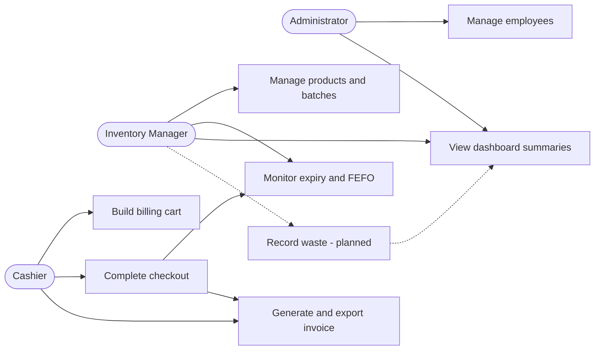

# Software Requirements Specification (SRS)

## Perishables Management System (PMS)

| Field | Value |
|---|---|
| Version | 1.1 — Release-aligned revision |
| Date | 6 November 2026 |
| Status | Revised draft for team review |
| Project | Perishables Management System |
| Team | Deeksha, Chris, Janhavi, Chiranth |
| Primary documentation owner | Member 4 — Chiranth |
| Technology | Python 3, PySide6, SQLite, SQLAlchemy, pytest, GitHub Actions |

> **Document status note:** This SRS describes the intended system requirements and distinguishes implemented functionality from planned or unverified requirements. Implementation status is aligned with the merged release branch where verified. Requirements marked Planned, Not implemented or Not verified must not be treated as completed features.

## Revision history

| Version | Date | Author | Change |
|---|---|---|---|
| 0.1 | 28 October 2026 | Team | Initial PMS scope and baseline |
| 1.0 | 5 November 2026 | Chiranth / Member 4 | Expanded inventory, billing, employee, waste, security and NFR scope |
| 1.1 | 6 November 2026 | Chiranth / Member 4 | Updated implementation status, release alignment and interface descriptions |

## Approval

| Role | Name | Approval |
|---|---|---|
| Team / Product representative | Team decision required | Pending |
| Developer representative | Team decision required | Pending |
| QA representative | Team decision required | Pending |

## 1. Introduction

### 1.1 Purpose

This Software Requirements Specification defines the functional and non-functional requirements for the Perishables Management System (PMS).

PMS is a desktop application intended to help retail stores manage perishable products, inventory batches, expiry dates, checkout, invoices and employee information.

This document provides a common basis for implementation, testing, review and project evaluation.

### 1.2 Scope

PMS is intended for a single retail-store deployment using a desktop graphical interface and a local relational database.

The current application provides the following functionality:

- Product catalogue management.
- Batch-level inventory management.
- Stock quantity tracking.
- Low-stock monitoring.
- Expiry tracking.
- First Expired, First Out (FEFO) stock allocation during checkout.
- Point-of-sale billing and cart management.
- Invoice generation and export.
- Employee profile management.
- Dashboard summaries.
- Light and dark interface themes.

The following are expanded or planned requirements and must not be considered implemented unless separately verified:

- Waste recording and waste reporting.
- Full user authentication and role-based access control.
- Advanced audit logging.
- Automated demand forecasting.
- Multi-store cloud synchronisation.
- Barcode hardware integration.
- External ERP/POS integration.
- Mobile applications.
- Supplier payment and accounting integration.

The current release is a locally operated desktop application. It does not claim to provide a distributed or cloud-based retail management platform.

### 1.3 Intended audience

The intended audience includes:

- Project team members.
- Instructors and evaluators.
- Developers.
- Testers.
- Future maintainers.

### 1.4 Definitions and abbreviations

- **PMS:** Perishables Management System.
- **SKU:** Stock Keeping Unit; a unique product identifier.
- **Batch:** A received quantity of a product sharing a batch code and expiry date.
- **FEFO:** First Expired, First Out; allocate stock from the valid batch with the earliest expiry date first.
- **POS:** Point of Sale.
- **FR:** Functional Requirement.
- **NFR:** Non-functional Requirement.
- **RTM:** Requirements Traceability Matrix.
- **RBAC:** Role-Based Access Control.
- **UAT:** User Acceptance Testing.
- **PII:** Personally Identifiable Information, such as customer contact details.

### 1.5 References

- Supplied PMS problem statement: An application to manage perishable products such as fresh fruits and vegetables in retail stores.
- Project scope and team planning documentation.
- Repository README.
- Supplied SRS, SAD and Test Plan templates.
- Supplied mini-project evaluation checklist and demonstration FAQs.
- Requirements Traceability Matrix maintained in `docs/RTM.md`.

## 2. Overall description

### 2.1 Product perspective

PMS is a Python desktop application developed using a layered modular monolith architecture.

The application uses:

- **Presentation layer:** PySide6 desktop graphical user interface.
- **Business logic layer:** Python service modules implementing application rules.
- **Data access layer:** SQLAlchemy ORM.
- **Database:** SQLite.
- **Testing:** pytest and related testing tools.
- **Continuous integration:** GitHub Actions.
- **Version control:** Git and GitHub.

The system is not designed as a distributed microservices application.

### 2.2 Product functions

The current application provides or supports the following functions:

1. Create, view and update product records.
2. Maintain product and inventory information.
3. Receive stock into identifiable batches.
4. Track available stock quantities.
5. Identify expired and soon-to-expire batches.
6. Allocate checkout quantities using FEFO.
7. Reject checkout when eligible stock is insufficient.
8. Maintain a billing cart.
9. Validate cart quantities and prices.
10. Generate invoice records.
11. Deduct stock after successful checkout.
12. Maintain employee profiles and active/inactive status.
13. Display dashboard summaries.
14. Export invoices.
15. Support light and dark interface themes.

The following are planned or require further verification:

- Waste recording and reporting.
- Full authentication and role-based permissions.
- Comprehensive audit history.
- Automated demand forecasting.
- Optional invoice email delivery and its deployment configuration.

### 2.3 User classes and characteristics

| User role | Main responsibilities | Access expectation |
|---|---|---|
| Administrator | Manage employees, configuration and overall operations | Full approved administrative access |
| Inventory manager | Maintain products, stock batches and expiry information | Inventory management functions |
| Cashier | Build billing carts, complete sales and generate invoices | POS and permitted invoice functions |
| Evaluator / maintainer | Review application behaviour, tests and technical documentation | Development and testing access |

**Implementation qualification:** These roles describe the intended user model. Full authentication and RBAC enforcement have not been confirmed in the current application. Employee profile management and cashier-related functionality are separate from a complete authentication system.

### 2.4 Operating environment

- Python 3.10 or newer.
- Python 3.12 is used in the repository CI configuration.
- Windows and macOS development environments.
- PySide6 desktop GUI.
- SQLAlchemy ORM.
- SQLite local database.
- Local workstation with sufficient storage for the database and invoice exports.

An internet connection is required for repository operations and any optional external email service. Core local inventory and billing operations should not depend on email availability.

### 2.5 Constraints

- The application uses Python, PySide6, SQLAlchemy and SQLite.
- Business data is persisted in SQLite through SQLAlchemy.
- Invoice history and stock integrity must be preserved.
- Historical records must not be silently deleted.
- Expired batches must not be allocated during FEFO checkout.
- Customer contact information must not be written to ordinary application logs.
- Credentials and real customer data must not be committed to source control.

### 2.6 Assumptions and dependencies

- Users have basic desktop application skills.
- Product and batch information is entered accurately by store staff.
- The workstation date and time are configured correctly.
- The local database is available and writable.
- Optional email delivery depends on external mail configuration and network availability.
- Tax and discount policies, role permissions, waste reasons and customer contact policies require team approval.

## 3. External interface requirements

### 3.1 User interface

The application provides a desktop graphical user interface with the following main navigation sections:

1. Dashboard.
2. Inventory.
3. POS / Cart.
4. Expiry Tracking.
5. Employee Management.

The interface supports light and dark themes.

Forms should identify required fields and display validation errors clearly. Operations that modify important records should provide suitable confirmation or validation.

**Scope qualification:** Waste Management and Reports are not part of the current operational navigation. Waste recording and reporting remain planned requirements and must not be represented as working features.

### 3.2 Hardware interfaces

No dedicated hardware interface is required for the current release.

The following are potential future integrations:

- Barcode scanners.
- Weighing scales.
- Receipt printers.
- Product label printers.

### 3.3 Software interfaces

- SQLite database accessed through SQLAlchemy.
- Local invoice export functionality.
- Optional SMTP or other configured email service, if enabled.
- GitHub Actions for continuous integration.
- GitHub for repository hosting and pull request review.

### 3.4 Communications

Core application functions operate locally.

Optional email delivery requires an external mail service. Email credentials must be stored outside source control.

The application should handle email or network errors without undoing an invoice that has already been successfully committed.

## 4. System features and functional requirements

Priority definitions:

- **P0:** Core functionality required for the current application.
- **P1:** Important expanded functionality.
- **P2:** Optional or future enhancement.

Implementation status describes the current release only. A requirement marked Planned or Not verified is not accepted as delivered.

### 4.1 Product and batch inventory

| ID | Requirement | Priority | Status / acceptance criteria |
|---|---|---|---|
| PMS-FR-001 | The system shall create products with a unique SKU, name, category, prices and optional supplier information. | P0 | Implemented. Duplicate SKUs and invalid required fields must be rejected. |
| PMS-FR-002 | The system shall allow users to view and update product details. | P0 | Product management functionality implemented. |
| PMS-FR-003 | The system shall support product deactivation without deleting historical inventory records. | P0 | Service-level support implemented. |
| PMS-FR-004 | The system shall record stock receipts as batches with batch code, received quantity, remaining quantity and expiry date. | P0 | Batch-level inventory functionality implemented. |
| PMS-FR-005 | The system shall calculate available stock from remaining batch quantities. | P0 | Implemented. Batch quantities are used as the basis for available stock. |
| PMS-FR-006 | The system shall identify products at or below their configured low-stock threshold. | P1 | Dashboard summary functionality implemented; boundary behaviour should be covered by tests. |

### 4.2 Expiry and stock rotation

| ID | Requirement | Priority | Status / acceptance criteria |
|---|---|---|---|
| PMS-FR-007 | The system shall identify batches whose expiry date is before the current date and whose remaining quantity is positive. | P0 | Implemented in expiry functionality. |
| PMS-FR-008 | The system shall identify batches expiring today or within a specified number of days. | P0 | Implemented. The dashboard uses a default seven-day horizon. |
| PMS-FR-009 | The system shall allocate sold quantities from valid batches in ascending expiry-date order. | P0 | FEFO allocation implemented in checkout logic. |
| PMS-FR-010 | The system shall reject checkout when requested quantity exceeds eligible, unexpired stock. | P0 | Implemented. Invalid checkout must not commit partial stock changes. |
| PMS-FR-011 | The system shall retain sufficient stock movement history to explain receipts, sales and adjustments. | P1 | Expanded requirement. Complete audit and adjustment coverage is not verified. |

### 4.3 Billing and invoices

| ID | Requirement | Priority | Status / acceptance criteria |
|---|---|---|---|
| PMS-FR-012 | The system shall allow the cashier to add products and positive quantities to a billing cart and revise or remove cart lines. | P0 | Cart and POS functionality implemented. |
| PMS-FR-013 | The system shall calculate line totals, subtotal, configured tax or discount and final total using decimal monetary arithmetic. | P0 | Billing calculations implemented. Final tax and discount policy requires team confirmation. |
| PMS-FR-014 | The system shall generate a unique invoice number and persist invoice headers and item snapshots. | P0 | Invoice generation implemented. |
| PMS-FR-015 | The system shall deduct stock only after a valid invoice is created and commit invoice and stock changes atomically. | P0 | Transactional checkout functionality implemented and covered by automated tests. |
| PMS-FR-016 | The system shall preserve cashier identity on each invoice. | P1 | Cashier attribution functionality is included in the merged release. |
| PMS-FR-017 | The system shall support optional customer mobile number and email capture according to an approved policy. | P1 | Fields are supported in the checkout/invoice scope; final policy and validation require confirmation. |
| PMS-FR-018 | The system shall export or print an invoice after successful checkout. | P0 | Invoice export functionality is present. |
| PMS-FR-019 | The system may email an invoice, and email failure shall not undo a completed sale. | P2 | Optional functionality. Deployment configuration and failure handling require separate verification. |

### 4.4 Employee management

| ID | Requirement | Priority | Status / acceptance criteria |
|---|---|---|---|
| PMS-FR-020 | The system shall create employee profiles with unique employee code, name, optional contact details and role. | P1 | Employee management functionality included in the merged release. |
| PMS-FR-021 | The system shall edit employee profile information while preventing duplicate employee codes or emails where applicable. | P1 | Employee profile editing functionality included in the merged release. |
| PMS-FR-022 | The system shall activate or deactivate employees without deleting historical invoice attribution. | P1 | Active/inactive employee support included in the merged release. |
| PMS-FR-023 | The system shall support cashier attribution to an eligible active employee. | P1 | Employee-related cashier attribution included in the merged release. |
| PMS-FR-024 | The system shall support an explicit on-leave status distinct from active/inactive. | P2 | Not confirmed in the current implementation. Future enhancement unless separately verified. |

### 4.5 Waste management

The following requirements describe expanded functionality. Waste Management is not an operational feature in the current release.

| ID | Requirement | Priority | Status / acceptance criteria |
|---|---|---|---|
| PMS-FR-025 | The system shall record a waste event against a product and, where known, its batch. | P1 | Not implemented. |
| PMS-FR-026 | The system shall capture waste quantity, date/time, reason, recorded-by employee and optional notes. | P1 | Not implemented. |
| PMS-FR-027 | The system shall validate that waste quantity is positive and does not exceed the batch's remaining quantity. | P1 | Not implemented. |
| PMS-FR-028 | The system shall deduct recorded waste from the relevant batch and preserve a traceable waste record in one transaction. | P1 | Not implemented. |
| PMS-FR-029 | The system shall provide waste summaries by date range, product, category and reason, including quantity and estimated cost. | P1 | Not implemented. Cost calculation policy requires agreement. |
| PMS-FR-030 | The system shall prevent expired or written-off stock from being sold after waste is recorded. | P1 | Not implemented as a waste workflow. Must be verified after implementation. |

### 4.6 Dashboard and reporting

| ID | Requirement | Priority | Status / acceptance criteria |
|---|---|---|---|
| PMS-FR-031 | The system shall display relevant inventory and sales summaries, including product count, low-stock count, expiring batches and sales information. | P1 | Dashboard summary functionality implemented. |
| PMS-FR-032 | The system shall display waste quantity and value summaries for a selected period. | P1 | Not implemented. |
| PMS-FR-033 | The system shall refresh displayed summaries from persisted records. | P1 | Dashboard data display is implemented. A separate refresh control is not claimed as part of the current release. |

## 5. Non-functional requirements

The following are proposed measurable acceptance targets for a single-workstation academic demonstration. They are not measured performance claims.

| ID | Quality attribute | Requirement / measurable acceptance criterion |
|---|---|---|
| PMS-NFR-001 | Performance | On an agreed demo dataset of up to 5,000 products and 20,000 batches, product search/list and dashboard refresh shall complete within 3 seconds for at least 95% of 20 repeated runs. |
| PMS-NFR-002 | Performance | A checkout containing up to 20 distinct cart lines shall complete database processing within 3 seconds for at least 95% of 20 runs, excluding human interaction and optional email delivery. |
| PMS-NFR-003 | Reliability / integrity | For 100 simulated checkout attempts, every successful checkout shall have one persisted invoice and the corresponding stock deduction. Every rejected or failed checkout shall leave invoice and stock data unchanged. |
| PMS-NFR-004 | Usability | A first-time test user, given a five-minute orientation, shall complete product lookup, add-to-cart and invoice generation without assistance in at least four of five observed attempts. |
| PMS-NFR-005 | Maintainability | Business rules shall reside in service modules rather than UI widgets. New service functions shall have automated tests, and the full pytest suite shall pass in CI before merge. |
| PMS-NFR-006 | Portability | The application shall install and launch on supported Windows and macOS development environments using documented setup steps and Python 3.10 or newer. Platform-specific failures shall be recorded. |
| PMS-NFR-007 | Data durability | After a successful commit and clean application restart, sampled products, batches and invoices shall remain readable in the local database. Waste records are subject to future implementation. |
| PMS-NFR-008 | Recoverability | A failed checkout transaction shall roll back all database changes in that operation. No partial invoice or stock state may remain. |

## 6. Security objectives and requirements

### 6.1 Security objectives

- **PMS-SO-001 — Confidentiality:** Prevent unauthorised access to or disclosure of employee and customer contact information.
- **PMS-SO-002 — Integrity:** Prevent unauthorised or inconsistent changes to stock, invoices, employee status and future waste records.
- **PMS-SO-003 — Accountability:** Preserve attributable records for sales, stock adjustments and future waste events so that actions can be reviewed.

### 6.2 Security requirements

| ID | Requirement | Verification |
|---|---|---|
| PMS-SEC-001 | The system shall require an authenticated user identity before permitting privileged inventory, employee or waste operations. | Attempt privileged actions without an authenticated session; access must be denied. Authentication is not confirmed in the current release. |
| PMS-SEC-002 | The system shall enforce role-based permissions for Administrator, Inventory Manager and Cashier actions. | Permission-matrix tests for each role/action. RBAC is not confirmed in the current release. |
| PMS-SEC-003 | The system shall not write customer mobile numbers, email addresses, passwords or secrets to ordinary application logs. | Inspect captured logs using synthetic sensitive test values. |
| PMS-SEC-004 | Email credentials and other secrets shall be supplied through protected environment or deployment configuration and shall not be committed to source control. | Repository secret scan and configuration review. |
| PMS-SEC-005 | The system shall validate user-supplied identifiers, quantities, dates, monetary values and text fields in the service layer, not only in the UI. | Unit tests for invalid, boundary and malformed inputs. |
| PMS-SEC-006 | The system shall preserve an audit record for completed invoices, employee status changes, stock adjustments and future waste events, including actor and timestamp where available. | Inspect persisted audit/history records. Full coverage is not confirmed. |

### 6.3 Privacy

Customer mobile and email fields are optional unless the team approves a stricter invoice policy.

Access to customer contact information should be limited to users with a business need.

Contact information should not be included in diagnostic logs or public demonstration screenshots.

Synthetic data should be used during testing and evaluation.

## 7. Quality attributes and acceptance tests

The following quality attributes define the expected behaviour of the system:

- **Inventory correctness:** Batch quantities must reconcile with stock summaries.
- **Expiry correctness:** Expired batches must be excluded from FEFO checkout.
- **Billing integrity:** Invoice and stock changes must commit atomically.
- **Employee attribution:** Invoice records should preserve cashier attribution.
- **Waste integrity:** When waste management is implemented, waste records and batch deductions must commit atomically.
- **Security:** Privileged actions must be denied to unauthorised roles once authentication and RBAC are implemented.
- **Performance:** The proposed NFR-001 and NFR-002 targets must be measured on a recorded reference workstation and dataset.
- **Portability:** Installation and launch must be verified on the supported operating systems.

## 8. UML use-case diagram

The following diagram represents the intended system use cases. Waste-related use cases are planned and do not indicate that the feature is currently operational.

## 9. Requirements Traceability Matrix

The complete requirement-to-test mapping is maintained in `docs/RTM.md`.

Each requirement has a unique identifier, priority, implementation state and verification reference.

Requirements marked Planned, Not implemented or Not verified are not accepted as delivered until implementation, testing and review are complete.

## 10. Implementation and release status

The current release has been merged into the `main` branch.

The following verification evidence has been recorded:

- Automated test suite: 111 tests passed.
- Clean-checkout verification: fresh clone, dependency installation, tests and application launch succeeded.
- Manual smoke tests: six tested application areas passed.
- Functional workflows: six tested workflows passed.
- GitHub pull request checks for PR #21 passed.
- Demonstration video saved at `docs/evidence/demo.mov`.
- Screenshots saved under `docs/evidence/screenshots/`.

The evidence is maintained in:

- `docs/RELEASE_CHECKLIST.md`
- `docs/MANUAL_TEST_EVIDENCE.md`
- `docs/evidence/`
